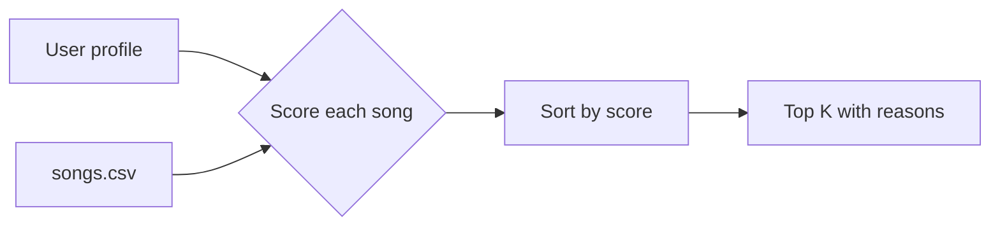

# 🎵 Music Recommender Simulation

## Project Summary

In this project you will build and explain a small music recommender system.

Your goal is to:

- Represent songs and a user "taste profile" as data
- Design a scoring rule that turns that data into recommendations
- Evaluate what your system gets right and wrong
- Reflect on how this mirrors real world AI recommenders

My version, **VibeMatch 1.0**, is a content-based recommender. It reads a catalog of songs from a CSV, compares every song to a user's taste profile, gives each one a score with the reasons behind it, and prints the top results in the terminal.

---

## How The System Works

### How real recommenders work

Apps like Spotify and YouTube mix two ideas:

- **Collaborative filtering** uses other people's behavior. If listeners who liked the songs I like also played a track I have not heard, it gets suggested to me. It needs a lot of history (plays, skips, likes, playlists) and it does not need to know anything about the song itself.
- **Content-based filtering** uses the song's own attributes (genre, mood, tempo, energy, acousticness) and compares them to what the user has liked before. It works for new songs with no history, but it tends to keep recommending more of the same.

In both cases there are three separate parts: the **input data** (song features and user behavior), the **user preferences** (a profile built from that behavior), and the **ranking** step that scores every candidate and keeps the best few.

My simulation is content-based only. There is no listening history, so the user profile is written by hand.

### Features

- `Song`: `genre`, `mood`, `energy`, `acousticness` are used for the base score. `popularity`, `release_decade`, `mood_tags`, `instrumentalness` and `explicit` are used only when the profile asks for them. `tempo_bpm`, `valence` and `danceability` are loaded but not scored.
- `UserProfile`: `favorite_genre`, `favorite_mood`, `target_energy`, `likes_acoustic`, plus optional `favorite_decade`, `mood_tags`, `prefers_popular`, `target_instrumentalness`, `allow_explicit`.

### Algorithm recipe

For each song:

| Rule | Points |
| --- | --- |
| Genre matches the user's favorite | +2.0 |
| Mood matches the user's favorite | +1.0 |
| Energy closeness: `1 - abs(song energy - target energy)` | up to +1.5 |
| Acoustic fit (only if the user states a preference) | up to +0.5 |

Energy uses closeness, not size, so a user who wants 0.4 is not pushed toward the loudest songs. Genre is worth the most because it is the first thing I would filter on myself.

The **scoring rule** judges one song. The **ranking rule** sorts all scored songs from highest to lowest and returns the top `k`. Both are needed: a score alone says nothing until it is compared against the rest of the catalog.



### Bias I expect

Genre is an exact text match worth 2 points, so a great song in a neighboring genre ("indie pop" for a "pop" fan) loses to a weaker song with the right label. Genres with more songs in the catalog will also fill more of the top 5.

---

## Getting Started

### Setup

```bash
python -m venv .venv
source .venv/bin/activate      # Mac or Linux
pip install -r requirements.txt
```

### Run

```bash
python -m src.main                        # all profiles, balanced mode
python -m src.main --mode mood-first      # balanced, genre-first, mood-first, energy-focused
python -m src.main --diverse              # penalize repeated artists and genres
python -m src.main --experiment           # weight-shift experiment
python -m src.main -k 3                   # change how many songs are returned
```

### Tests

```bash
pytest
```

```
...............                                                          [100%]
15 passed in 0.01s
```

The 15 tests cover CSV loading, the scoring rules, ranking order, weight overrides, the advanced attributes, the ranking modes and the diversity penalty.

---

## Sample Recommendation Output

```
$ python -m src.main\nLoaded songs: 20
Ranking mode: balanced (Recipe from the README: genre 2.0, mood 1.0, energy 1.5)
Diversity penalty: off

=== High-Energy Pop ===
Profile: {'genre': 'pop', 'mood': 'happy', 'energy': 0.85}
+-----+----------------+---------------+-----------+---------+------------------------------------+
| #   | Title          | Artist        | Genre     | Score   | Reasons                            |
+=====+================+===============+===========+=========+====================================+
| 1   | Sunrise City   | Neon Echo     | pop       | 4.46    | genre match: pop (+2.00)           |
|     |                |               |           |         | mood match: happy (+1.00)          |
|     |                |               |           |         | energy 0.82 vs target 0.85 (+1.46) |
+-----+----------------+---------------+-----------+---------+------------------------------------+
| 2   | Gym Hero       | Max Pulse     | pop       | 3.38    | genre match: pop (+2.00)           |
|     |                |               |           |         | energy 0.93 vs target 0.85 (+1.38) |
+-----+----------------+---------------+-----------+---------+------------------------------------+
| 3   | Rooftop Lights | Indigo Parade | indie pop | 2.37    | mood match: happy (+1.00)          |
|     |                |               |           |         | energy 0.76 vs target 0.85 (+1.36) |
+-----+----------------+---------------+-----------+---------+------------------------------------+
| 4   | Fuego Lento    | Marisol Cruz  | latin     | 1.43    | energy 0.80 vs target 0.85 (+1.43) |
+-----+----------------+---------------+-----------+---------+------------------------------------+
| 5   | Storm Runner   | Voltline      | rock      | 1.41    | energy 0.91 vs target 0.85 (+1.41) |
+-----+----------------+---------------+-----------+---------+------------------------------------+
```

Each row carries its own explanation: the Reasons column lists every rule that fired and the points it added.

---

## Profile Runs

Same command, remaining profiles.

```
=== Chill Lofi ===
Profile: {'genre': 'lofi', 'mood': 'chill', 'energy': 0.35, 'likes_acoustic': True}
+-----+---------------------+----------------+---------+---------+------------------------------------+
| #   | Title               | Artist         | Genre   | Score   | Reasons                            |
+=====+=====================+================+=========+=========+====================================+
| 1   | Library Rain        | Paper Lanterns | lofi    | 4.93    | genre match: lofi (+2.00)          |
|     |                     |                |         |         | mood match: chill (+1.00)          |
|     |                     |                |         |         | energy 0.35 vs target 0.35 (+1.50) |
|     |                     |                |         |         | acoustic fit (+0.43)               |
+-----+---------------------+----------------+---------+---------+------------------------------------+
| 2   | Midnight Coding     | LoRoom         | lofi    | 4.75    | genre match: lofi (+2.00)          |
|     |                     |                |         |         | mood match: chill (+1.00)          |
|     |                     |                |         |         | energy 0.42 vs target 0.35 (+1.40) |
|     |                     |                |         |         | acoustic fit (+0.35)               |
+-----+---------------------+----------------+---------+---------+------------------------------------+
| 3   | Focus Flow          | LoRoom         | lofi    | 3.81    | genre match: lofi (+2.00)          |
|     |                     |                |         |         | energy 0.40 vs target 0.35 (+1.42) |
|     |                     |                |         |         | acoustic fit (+0.39)               |
+-----+---------------------+----------------+---------+---------+------------------------------------+
| 4   | Spacewalk Thoughts  | Orbit Bloom    | ambient | 2.85    | mood match: chill (+1.00)          |
|     |                     |                |         |         | energy 0.28 vs target 0.35 (+1.40) |
|     |                     |                |         |         | acoustic fit (+0.46)               |
+-----+---------------------+----------------+---------+---------+------------------------------------+
| 5   | Coffee Shop Stories | Slow Stereo    | jazz    | 1.92    | energy 0.37 vs target 0.35 (+1.47) |
|     |                     |                |         |         | acoustic fit (+0.45)               |
+-----+---------------------+----------------+---------+---------+------------------------------------+
```

```
=== Deep Intense Rock ===
Profile: {'genre': 'rock', 'mood': 'intense', 'energy': 0.95}
+-----+--------------+-----------+---------+---------+------------------------------------+
| #   | Title        | Artist    | Genre   | Score   | Reasons                            |
+=====+==============+===========+=========+=========+====================================+
| 1   | Storm Runner | Voltline  | rock    | 4.44    | genre match: rock (+2.00)          |
|     |              |           |         |         | mood match: intense (+1.00)        |
|     |              |           |         |         | energy 0.91 vs target 0.95 (+1.44) |
+-----+--------------+-----------+---------+---------+------------------------------------+
| 2   | Gym Hero     | Max Pulse | pop     | 2.47    | mood match: intense (+1.00)        |
|     |              |           |         |         | energy 0.93 vs target 0.95 (+1.47) |
+-----+--------------+-----------+---------+---------+------------------------------------+
| 3   | Laser Bloom  | Kilo Flux | edm     | 1.50    | energy 0.95 vs target 0.95 (+1.50) |
+-----+--------------+-----------+---------+---------+------------------------------------+
| 4   | Iron Verdict | Graveline | metal   | 1.47    | energy 0.97 vs target 0.95 (+1.47) |
+-----+--------------+-----------+---------+---------+------------------------------------+
| 5   | Sunrise City | Neon Echo | pop     | 1.30    | energy 0.82 vs target 0.95 (+1.30) |
+-----+--------------+-----------+---------+---------+------------------------------------+
```

```
=== Adversarial: Sad but Hyper ===
Profile: {'genre': 'blues', 'mood': 'sad', 'energy': 0.95}
+-----+----------------------+-----------+---------+---------+------------------------------------+
| #   | Title                | Artist    | Genre   | Score   | Reasons                            |
+=====+======================+===========+=========+=========+====================================+
| 1   | Empty Platform Blues | Otis Kane | blues   | 3.57    | genre match: blues (+2.00)         |
|     |                      |           |         |         | mood match: sad (+1.00)            |
|     |                      |           |         |         | energy 0.33 vs target 0.95 (+0.57) |
+-----+----------------------+-----------+---------+---------+------------------------------------+
| 2   | Laser Bloom          | Kilo Flux | edm     | 1.50    | energy 0.95 vs target 0.95 (+1.50) |
+-----+----------------------+-----------+---------+---------+------------------------------------+
| 3   | Gym Hero             | Max Pulse | pop     | 1.47    | energy 0.93 vs target 0.95 (+1.47) |
+-----+----------------------+-----------+---------+---------+------------------------------------+
| 4   | Iron Verdict         | Graveline | metal   | 1.47    | energy 0.97 vs target 0.95 (+1.47) |
+-----+----------------------+-----------+---------+---------+------------------------------------+
| 5   | Storm Runner         | Voltline  | rock    | 1.44    | energy 0.91 vs target 0.95 (+1.44) |
+-----+----------------------+-----------+---------+---------+------------------------------------+
```

```
=== Adversarial: Ghost Genre ===
Profile: {'genre': 'k-pop', 'mood': 'happy', 'energy': 0.5}
+-----+------------------+---------------+-----------+---------+------------------------------------+
| #   | Title            | Artist        | Genre     | Score   | Reasons                            |
+=====+==================+===============+===========+=========+====================================+
| 1   | Rooftop Lights   | Indigo Parade | indie pop | 2.11    | mood match: happy (+1.00)          |
|     |                  |               |           |         | energy 0.76 vs target 0.50 (+1.11) |
+-----+------------------+---------------+-----------+---------+------------------------------------+
| 2   | Sunrise City     | Neon Echo     | pop       | 2.02    | mood match: happy (+1.00)          |
|     |                  |               |           |         | energy 0.82 vs target 0.50 (+1.02) |
+-----+------------------+---------------+-----------+---------+------------------------------------+
| 3   | Island Slow Burn | Rootsway      | reggae    | 1.50    | energy 0.50 vs target 0.50 (+1.50) |
+-----+------------------+---------------+-----------+---------+------------------------------------+
| 4   | Dust Road Radio  | Hank Marlow   | country   | 1.47    | energy 0.52 vs target 0.50 (+1.47) |
+-----+------------------+---------------+-----------+---------+------------------------------------+
| 5   | Velvet Hours     | Sana Reyes    | r&b       | 1.47    | energy 0.48 vs target 0.50 (+1.47) |
+-----+------------------+---------------+-----------+---------+------------------------------------+
```

```
=== Focus Session ===
Profile: {'genre': 'lofi', 'mood': 'focused', 'energy': 0.4, 'target_instrumentalness': 0.9, 'mood_tags': ['mellow', 'steady'], 'favorite_decade': 2020, 'prefers_popular': False}
+-----+--------------------+----------------+---------+---------+------------------------------------+
| #   | Title              | Artist         | Genre   | Score   | Reasons                            |
+=====+====================+================+=========+=========+====================================+
| 1   | Focus Flow         | LoRoom         | lofi    | 6.70    | genre match: lofi (+2.00)          |
|     |                    |                |         |         | mood match: focused (+1.00)        |
|     |                    |                |         |         | energy 0.40 vs target 0.40 (+1.50) |
|     |                    |                |         |         | decade match: 2020s (+0.50)        |
|     |                    |                |         |         | mood tags: mellow, steady (+1.00)  |
|     |                    |                |         |         | hidden gem, popularity 58 (+0.21)  |
|     |                    |                |         |         | instrumentalness 0.92 (+0.49)      |
+-----+--------------------+----------------+---------+---------+------------------------------------+
| 2   | Library Rain       | Paper Lanterns | lofi    | 5.15    | genre match: lofi (+2.00)          |
|     |                    |                |         |         | energy 0.35 vs target 0.40 (+1.42) |
|     |                    |                |         |         | decade match: 2020s (+0.50)        |
|     |                    |                |         |         | mood tags: mellow (+0.50)          |
|     |                    |                |         |         | hidden gem, popularity 55 (+0.22)  |
|     |                    |                |         |         | instrumentalness 0.90 (+0.50)      |
+-----+--------------------+----------------+---------+---------+------------------------------------+
| 3   | Midnight Coding    | LoRoom         | lofi    | 5.14    | genre match: lofi (+2.00)          |
|     |                    |                |         |         | energy 0.42 vs target 0.40 (+1.47) |
|     |                    |                |         |         | decade match: 2020s (+0.50)        |
|     |                    |                |         |         | mood tags: mellow (+0.50)          |
|     |                    |                |         |         | hidden gem, popularity 61 (+0.20)  |
|     |                    |                |         |         | instrumentalness 0.85 (+0.47)      |
+-----+--------------------+----------------+---------+---------+------------------------------------+
| 4   | Spacewalk Thoughts | Orbit Bloom    | ambient | 2.35    | energy 0.28 vs target 0.40 (+1.32) |
|     |                    |                |         |         | neighboring decade: 2010s (+0.25)  |
|     |                    |                |         |         | hidden gem, popularity 40 (+0.30)  |
|     |                    |                |         |         | instrumentalness 0.95 (+0.48)      |
+-----+--------------------+----------------+---------+---------+------------------------------------+
| 5   | Island Slow Burn   | Rootsway       | reggae  | 2.17    | energy 0.50 vs target 0.40 (+1.35) |
|     |                    |                |         |         | mood tags: mellow (+0.50)          |
|     |                    |                |         |         | hidden gem, popularity 57 (+0.22)  |
|     |                    |                |         |         | instrumentalness 0.10 (+0.10)      |
+-----+--------------------+----------------+---------+---------+------------------------------------+
```

```
=== Clean Workout ===
Profile: {'genre': 'pop', 'mood': 'intense', 'energy': 0.9, 'allow_explicit': False, 'prefers_popular': True}
+-----+--------------+--------------+---------+---------+-------------------------------------+
| #   | Title        | Artist       | Genre   | Score   | Reasons                             |
+=====+==============+==============+=========+=========+=====================================+
| 1   | Sunrise City | Neon Echo    | pop     | 3.79    | genre match: pop (+2.00)            |
|     |              |              |         |         | energy 0.82 vs target 0.90 (+1.38)  |
|     |              |              |         |         | popular pick, popularity 82 (+0.41) |
+-----+--------------+--------------+---------+---------+-------------------------------------+
| 2   | Gym Hero     | Max Pulse    | pop     | 2.90    | genre match: pop (+2.00)            |
|     |              |              |         |         | mood match: intense (+1.00)         |
|     |              |              |         |         | energy 0.93 vs target 0.90 (+1.46)  |
|     |              |              |         |         | popular pick, popularity 88 (+0.44) |
|     |              |              |         |         | explicit content (-2.00)            |
+-----+--------------+--------------+---------+---------+-------------------------------------+
| 3   | Storm Runner | Voltline     | rock    | 2.83    | mood match: intense (+1.00)         |
|     |              |              |         |         | energy 0.91 vs target 0.90 (+1.48)  |
|     |              |              |         |         | popular pick, popularity 70 (+0.35) |
+-----+--------------+--------------+---------+---------+-------------------------------------+
| 4   | Laser Bloom  | Kilo Flux    | edm     | 1.82    | energy 0.95 vs target 0.90 (+1.43)  |
|     |              |              |         |         | popular pick, popularity 79 (+0.40) |
+-----+--------------+--------------+---------+---------+-------------------------------------+
| 5   | Fuego Lento  | Marisol Cruz | latin   | 1.75    | energy 0.80 vs target 0.90 (+1.35)  |
|     |              |              |         |         | popular pick, popularity 80 (+0.40) |
+-----+--------------+--------------+---------+---------+-------------------------------------+
```

What changed between profiles:

- **High-Energy Pop vs Chill Lofi:** no songs in common. Pop pulls energy above 0.75; lofi pulls energy near 0.35 and high acousticness.
- **High-Energy Pop vs Deep Intense Rock:** both want high energy, so they share Gym Hero, Sunrise City and Storm Runner, but in a different order because the genre and mood points go to different songs.
- **Chill Lofi vs Deep Intense Rock:** opposite ends of the energy scale, nothing in common.
- **Sad but Hyper:** the top pick is a slow blues song (energy 0.33) for a user who asked for 0.95. Genre plus mood (3.0) beats the most energy can give (1.5).
- **Ghost Genre:** "k-pop" is not in the catalog. The system does not warn the user; it quietly falls back to mood and energy.
- **Focus Session vs Chill Lofi:** same genre, but the mood, tags and instrumentalness move Focus Flow from third to first.
- **Clean Workout:** Gym Hero is the best match on paper but drops to second because of the explicit penalty.

---

## Experiments You Tried

**1. Weight shift (energy x2, genre x0.5)** with `python -m src.main --experiment`:

```
=== High-Energy Pop (experiment: genre 1.0, energy 3.0) ===
Profile: {'genre': 'pop', 'mood': 'happy', 'energy': 0.85}
+-----+----------------+---------------+-----------+---------+------------------------------------+
| #   | Title          | Artist        | Genre     | Score   | Reasons                            |
+=====+================+===============+===========+=========+====================================+
| 1   | Sunrise City   | Neon Echo     | pop       | 4.91    | genre match: pop (+1.00)           |
|     |                |               |           |         | mood match: happy (+1.00)          |
|     |                |               |           |         | energy 0.82 vs target 0.85 (+2.91) |
+-----+----------------+---------------+-----------+---------+------------------------------------+
| 2   | Gym Hero       | Max Pulse     | pop       | 3.76    | genre match: pop (+1.00)           |
|     |                |               |           |         | energy 0.93 vs target 0.85 (+2.76) |
+-----+----------------+---------------+-----------+---------+------------------------------------+
| 3   | Rooftop Lights | Indigo Parade | indie pop | 3.73    | mood match: happy (+1.00)          |
|     |                |               |           |         | energy 0.76 vs target 0.85 (+2.73) |
+-----+----------------+---------------+-----------+---------+------------------------------------+
| 4   | Fuego Lento    | Marisol Cruz  | latin     | 2.85    | energy 0.80 vs target 0.85 (+2.85) |
+-----+----------------+---------------+-----------+---------+------------------------------------+
| 5   | Storm Runner   | Voltline      | rock      | 2.82    | energy 0.91 vs target 0.85 (+2.82) |
+-----+----------------+---------------+-----------+---------+------------------------------------+
```

The order did not change, but the gap between Gym Hero and Rooftop Lights went from 1.01 points to 0.03. Songs with no genre or mood match also scored much higher (Fuego Lento 1.43 to 2.85). The result is different more than it is better: energy alone cannot tell pop from latin or rock.

**2. Ranking modes** with `--mode`. For the "Sad but Hyper" profile, `energy-focused` gives the opposite answer from the balanced recipe. The blues song leaves the top 5:

```
=== Adversarial: Sad but Hyper ===
Profile: {'genre': 'blues', 'mood': 'sad', 'energy': 0.95}
+-----+--------------+-----------+---------+---------+------------------------------------+
| #   | Title        | Artist    | Genre   | Score   | Reasons                            |
+=====+==============+===========+=========+=========+====================================+
| 1   | Laser Bloom  | Kilo Flux | edm     | 4.00    | energy 0.95 vs target 0.95 (+4.00) |
+-----+--------------+-----------+---------+---------+------------------------------------+
| 2   | Gym Hero     | Max Pulse | pop     | 3.92    | energy 0.93 vs target 0.95 (+3.92) |
+-----+--------------+-----------+---------+---------+------------------------------------+
| 3   | Iron Verdict | Graveline | metal   | 3.92    | energy 0.97 vs target 0.95 (+3.92) |
+-----+--------------+-----------+---------+---------+------------------------------------+
| 4   | Storm Runner | Voltline  | rock    | 3.84    | energy 0.91 vs target 0.95 (+3.84) |
+-----+--------------+-----------+---------+---------+------------------------------------+
| 5   | Sunrise City | Neon Echo | pop     | 3.48    | energy 0.82 vs target 0.95 (+3.48) |
+-----+--------------+-----------+---------+---------+------------------------------------+
```

**3. Diversity penalty** with `--diverse`. For Chill Lofi the third lofi song (Focus Flow, second song by LoRoom) drops out and a folk song takes its place:

```
=== Chill Lofi ===
Profile: {'genre': 'lofi', 'mood': 'chill', 'energy': 0.35, 'likes_acoustic': True}
+-----+---------------------+----------------+---------+---------+------------------------------------+
| #   | Title               | Artist         | Genre   | Score   | Reasons                            |
+=====+=====================+================+=========+=========+====================================+
| 1   | Library Rain        | Paper Lanterns | lofi    | 4.93    | genre match: lofi (+2.00)          |
|     |                     |                |         |         | mood match: chill (+1.00)          |
|     |                     |                |         |         | energy 0.35 vs target 0.35 (+1.50) |
|     |                     |                |         |         | acoustic fit (+0.43)               |
+-----+---------------------+----------------+---------+---------+------------------------------------+
| 2   | Midnight Coding     | LoRoom         | lofi    | 4.00    | genre match: lofi (+2.00)          |
|     |                     |                |         |         | mood match: chill (+1.00)          |
|     |                     |                |         |         | energy 0.42 vs target 0.35 (+1.40) |
|     |                     |                |         |         | acoustic fit (+0.35)               |
|     |                     |                |         |         | repeat genre (-0.75)               |
+-----+---------------------+----------------+---------+---------+------------------------------------+
| 3   | Spacewalk Thoughts  | Orbit Bloom    | ambient | 2.85    | mood match: chill (+1.00)          |
|     |                     |                |         |         | energy 0.28 vs target 0.35 (+1.40) |
|     |                     |                |         |         | acoustic fit (+0.46)               |
+-----+---------------------+----------------+---------+---------+------------------------------------+
| 4   | Coffee Shop Stories | Slow Stereo    | jazz    | 1.92    | energy 0.37 vs target 0.35 (+1.47) |
|     |                     |                |         |         | acoustic fit (+0.45)               |
+-----+---------------------+----------------+---------+---------+------------------------------------+
| 5   | Paper Boats         | Wren & Willow  | folk    | 1.89    | energy 0.30 vs target 0.35 (+1.42) |
|     |                     |                |         |         | acoustic fit (+0.47)               |
+-----+---------------------+----------------+---------+---------+------------------------------------+
```

---

## Stretch Features

| Feature | Where |
| --- | --- |
| 5 new song attributes (`popularity`, `release_decade`, `mood_tags`, `instrumentalness`, `explicit`) | `data/songs.csv`, `_score_advanced()` in `src/recommender.py` |
| Diversity penalty (artist -1.5, genre -0.75 per repeat) | `diversify()` in `src/recommender.py`, `--diverse` |
| Ranking modes with a Strategy pattern | `ScoringStrategy` and subclasses, `--mode` |
| Table output with reasons | `print_recommendations()` in `src/main.py`, using `tabulate` |

The AI workflow for these is logged in [ai_interactions.md](ai_interactions.md).

---

## Limitations and Risks

- The catalog has 20 songs. Most genres have one song, so after the first match the list is filled by energy alone.
- Genre and mood are exact text matches. "indie pop" earns nothing for a "pop" fan.
- A genre that is not in the catalog fails silently.
- It knows nothing about lyrics, language, or what the user actually played.

More detail in the [Model Card](model_card.md).

---

## Reflection

Full version in the [**Model Card**](model_card.md).

A recommender turns data into a prediction by reducing both the song and the listener to the same few numbers and labels, then measuring how close they are. The "prediction" is only as good as those numbers. My system had no trouble with listeners whose taste fit one genre label, and it gave a strange answer as soon as two preferences disagreed.

Bias came from two places I did not expect to matter so much: how many songs each genre has in the CSV, and the weights I picked by hand. Lofi fans get three real matches and blues fans get one. Nobody decided that on purpose; it is just what the data and a 2.0 genre weight produce together.
